<div align="center">

# Polaroid Style Generator

<p>
  <strong>一个处理图片的工具，给图片添加拍立得边框（或等距边框和无边框），以及多种复古和艺术效果风格</strong>
</p>

<p>
  
  
  
</p>

<p>
  <sub>新年快乐呀🎉 今天下午调了下去花火大会拍的图，想着加上点效果会更好，就顺便写了这个项目</sub><br>
  <sub>希望能帮助到你哦，后续可能会增加更多效果，或让现有效果更加高级些，看 Star 和心情吧 😋</sub>
</p>

</div>

---

## 📑 目录

> 💡 **使用者直接看 [使用方法](#5-使用方法)**

- [1. 安装说明](#1-安装说明)
- [2. 项目结构](#2-项目结构)
- [3. 功能特性](#3-功能特性)
  - [框架样式](#框架样式)
  - [色彩效果](#色彩效果)
  - [处理特点](#处理特点)
- [4. 内置图片压缩工具](#4-内置图片压缩工具)
- [5. 使用方法](#5-使用方法)
- [6. 技术实现](#6-技术实现)
- [7. 维护说明](#7-维护说明)
- [8. 贡献指南](#8-贡献指南)
- [9. 命令行使用](#9-命令行使用)
- [10. License](#10-license)

---

## 📦 1. 安装说明

### 1. 下载项目
```bash
# 克隆项目
git clone https://github.com/sacilave/polaroid-style-generator.git

# 进入项目目录
cd polaroid-style-generator
```

### 2. 环境要求
- Python 3.6 或更高版本
- pip (Python包管理器)

### 3. 安装依赖
```bash
# 使用 pip 安装所需的包
pip install -r requirements.txt

# 或者直接安装必需的包
pip install Pillow==10.0.0
pip install numpy==1.24.3
```

### 4. 创建必要的目录
```bash
# 创建输入输出目录
mkdir -p images/input images/output
```

### 5. 准备图片
- 将要处理的图片重命名为 `input.jpg`
- 将图片放入 `images/input/` 目录

### 6. 运行程序
```bash
# 基本使用（使用拍立得框架）
python main.py -f polaroid

# 查看帮助
python main.py --help
```

---

## 📂 2. 项目结构

```text
PolaroidStyleGenerator/
├── main.py              # 主程序入口
├── image_enhancer.py    # 图片处理核心类
├── annotation_worker.py # 拍立得文字排版渲染引擎（独立隔离子进程）
├── compress_images.py   # 内置图片压缩工具
├── run.bat              # Windows 启动脚本
├── 点我运行.bat          # Windows 双击运行入口
├── requirements.txt     # 项目依赖配置
└── images/              # 图片目录
    ├── input/           # 输入图片目录
    ├── output/          # 输出图片目录
    └── converted/       # 格式转换导出目录
```

---

## ✨ 3. 功能特性

### 框架样式
| 🖼️ | 🎞️ | 📸 |
|:---:|:---:|:---:|
| **original**<br>无框架，保持原始尺寸<br>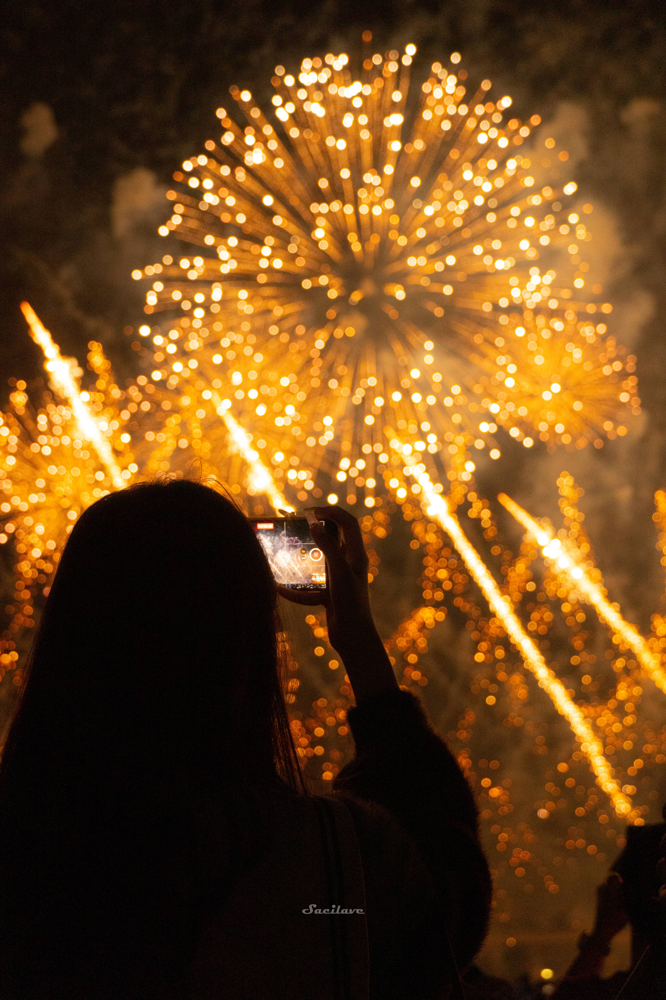 | **polaroid**<br>经典拍立得框架（底部加宽）<br>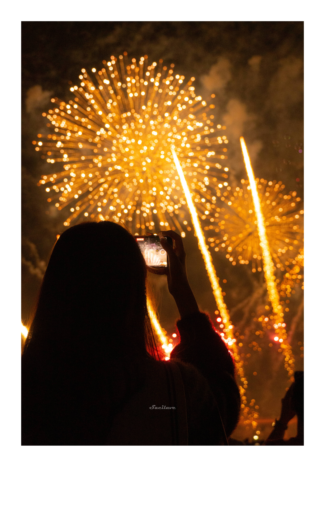 | **symmetric**<br>对称边框（四边等宽）<br>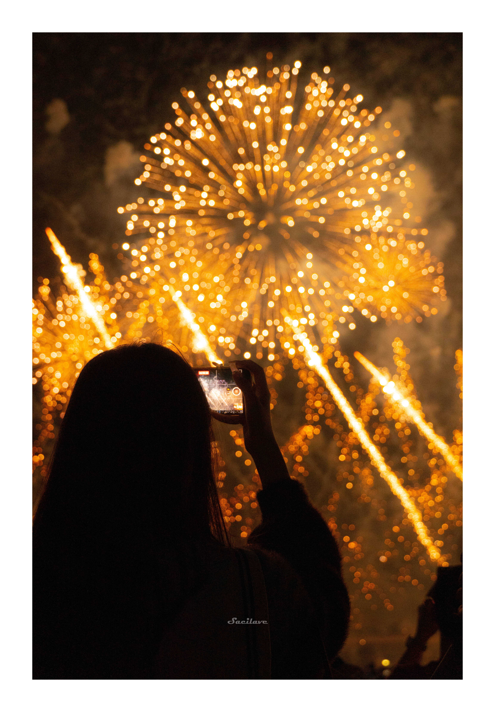 |

### 色彩效果
| ❤️ | 🎉 | 👍 |
|:---:|:---:|:---:|
| **原图**<br>原始图片<br>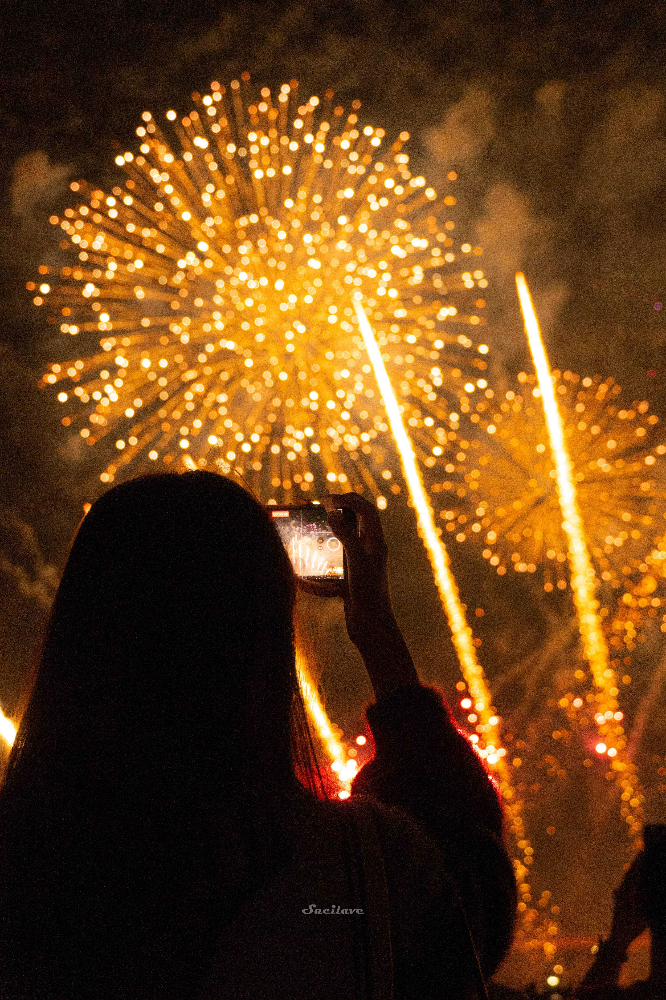 | **无效果**<br>无任何滤镜效果<br> | **vintage**<br>经典复古褪色效果<br>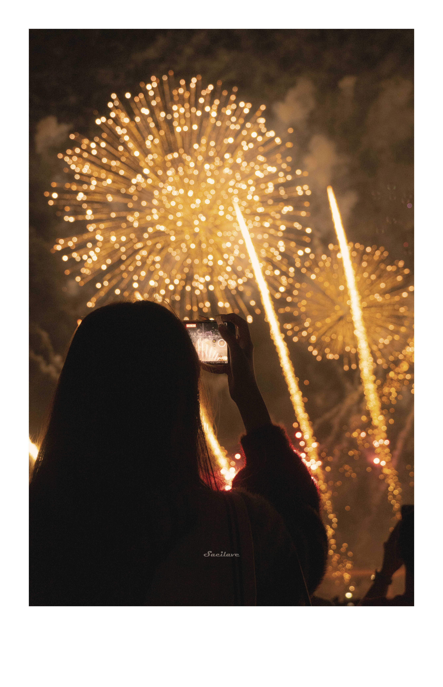 |
| **bw_classic**<br>经典黑白效果<br>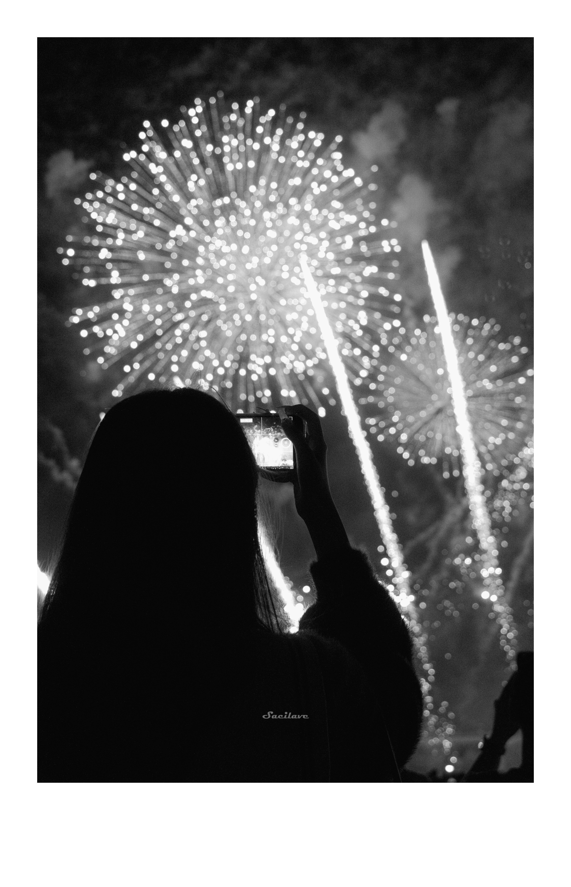 | **bw_high_contrast**<br>高对比度黑白<br>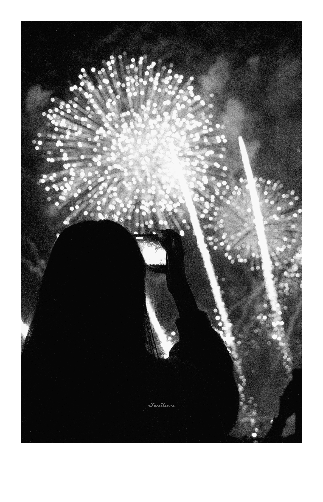 | **bw_soft**<br>柔和黑白<br> |
| **instant_70s**<br>70年代风格（偏绿）<br> | **instant_80s**<br>80年代风格（偏暖）<br>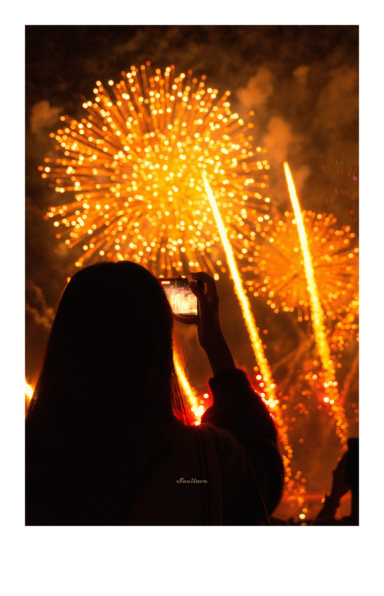 | **instant_90s**<br>90年代风格（自然）<br>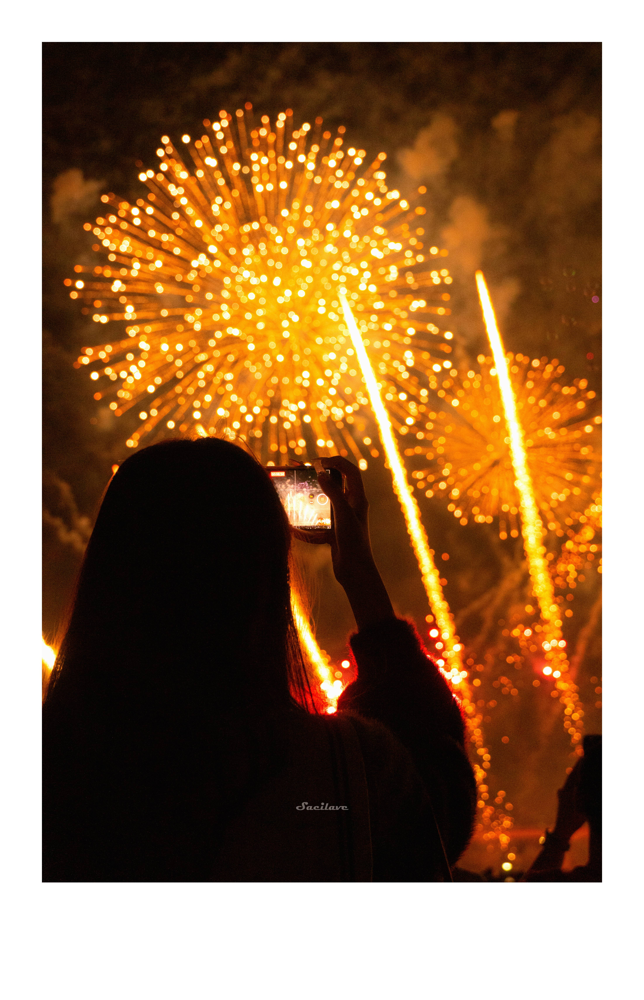 |
| **cross_process**<br>标准交叉冲洗<br> | **cross_light**<br>轻度交叉冲洗<br>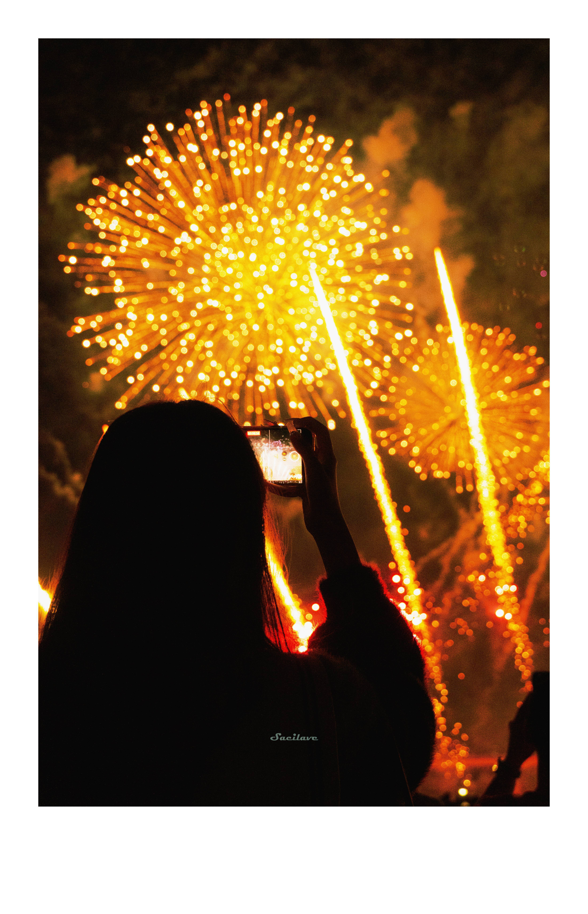 | **cross_strong**<br>强烈交叉冲洗<br>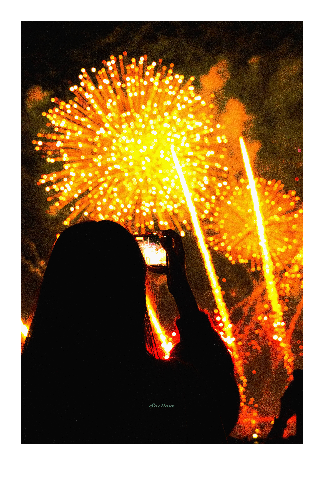 |
| **cinematic_kodak**<br>柯达风格（暖色调）<br> | **cinematic_fuji**<br>富士风格（清爽）<br>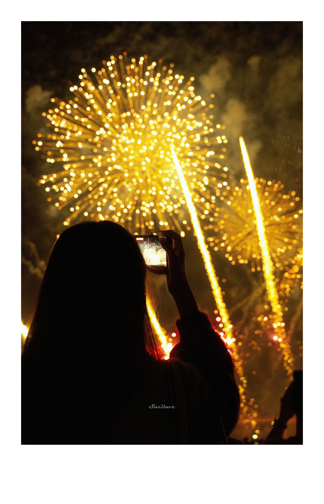 | **cinematic_vision3**<br>Vision3风格（自然）<br>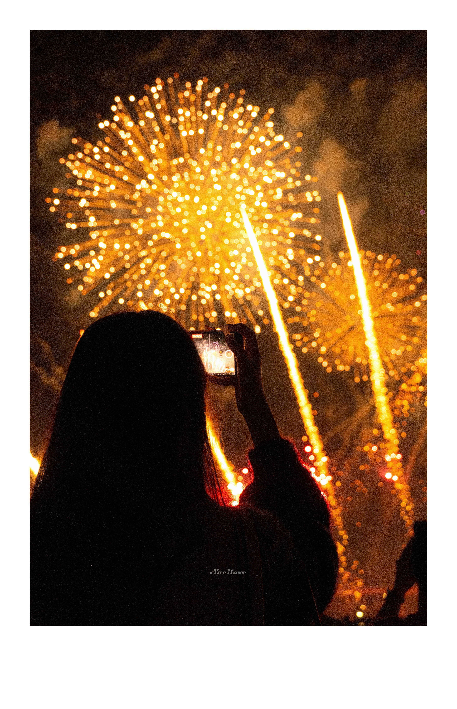 |
| **retro_60s**<br>60年代风格（高饱和）<br> | **retro_70s**<br>70年代风格（偏黄）<br> | **retro_80s**<br>80年代风格（偏红）<br>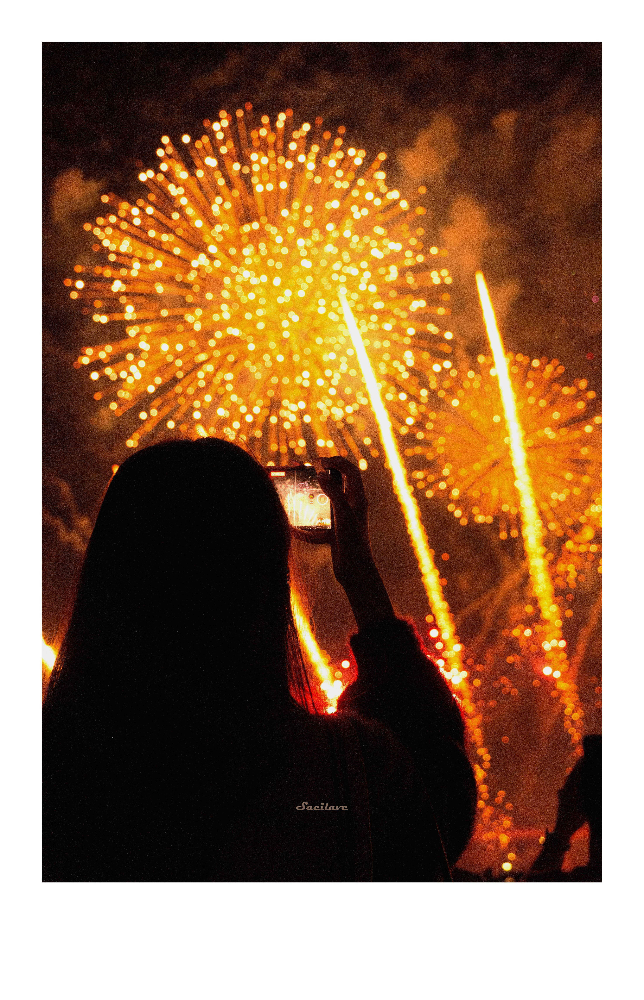 |

### 处理特点
- 框架和色彩效果可自由组合
- 保持原图分辨率不变
- 高质量图片输出
- 细腻的颗粒感效果
- 独特的色彩处理

---

## 🗜️ 4. 内置图片压缩工具

### 方法一、
[点击看直接使用的指令](#压缩图片)

### 方法二、
先在 `compress_images.py` 中设置要压缩的目录，然后运行脚本：

```python
dir = " "  # 引号内填入要压缩的图片目录
compress_images(dir)
```

```bash
# 然后运行压缩脚本
python compress_images.py
```

> [!WARNING]
> **！注意 ！会直接覆盖原图，记得提前备份！！！**

压缩工具特点：
- 支持 JPG、JPEG、PNG 格式
- 自动将 PNG 转换为 JPEG 以获得更好的压缩效果
- 可调节压缩质量（默认70%）
- 保持原始文件名和位置
- 优化文件大小

---

## 🚀 5. 使用方法

### 1. 使用批处理脚本（推荐）

提供了批处理脚本供选择：
- `点我运行.bat` - Windows 一键中文菜单交互入口
- `run.bat` - 命令行快捷启动入口

#### 使用步骤：
1. 将要处理的图片命名为 `input.jpg`（或直接将多张图片拖入 `images/input/` 目录）
2. 放入 `images/input/` 目录
3. 双击运行 `点我运行.bat` 或 `run.bat`
4. 根据菜单提示进行操作

#### 功能菜单：
1. **快捷菜单** - 常用效果组合的快捷操作
   - 拍立得框架相关效果
   - 对称边框相关效果
   - 随机组合生成
   - 一键生成所有效果

2. **直接输入编号** - 通过输入编号自由组合效果
   - 输入框架编号生成该框架的所有效果
   - 输入"框架编号 色彩编号"生成指定组合
   - 例如：`1 1` 生成拍立得框架+复古效果

3. **压缩图片** - 内置图片压缩功能
   - 压缩指定目录下的图片
   - 快捷压缩 output 目录下的图片
   - 可自定义压缩质量（1-100）

### 2. 使用命令行（高级用户）

> 如果您更习惯使用命令行，可以继续查看 [命令行使用](#9-命令行使用)

---

## 🛠️ 6. 技术实现

### 核心类
- `StyleProcessor`: 样式处理器基类
- `PolaroidStyle`: 拍立得框架实现
- `SymmetricPolaroidStyle`: 对称框架实现
- `BWFilmStyle`: 黑白胶片效果
- `InstantStyle`: 即时显影效果
- `CrossProcessStyle`: 交叉冲洗效果
- `CinematicStyle`: 电影胶片效果
- `RetroColorStyle`: 复古彩色效果
- `ImageEnhancer`: 图片增强器主类

### 扩展性设计
- 采用抽象基类设计
- 框架和色彩效果分离
- 支持轻松添加新的处理器
- 灵活的参数配置系统

---

## 🔧 7. 维护说明

### 添加新框架
1. 在 `image_enhancer.py` 中创建新的框架处理器类
2. 继承 `StyleProcessor` 基类
3. 实现 `process` 方法
4. 在 `ImageEnhancer.frame_processors` 中注册

### 添加新色彩效果
1. 在 `image_enhancer.py` 中创建新的色彩处理器类
2. 继承 `StyleProcessor` 基类
3. 实现 `process` 方法
4. 在 `ImageEnhancer.color_processors` 中注册

### 代码规范
- 遵循 PEP 8 编码规范
- 保持类和方法的单一职责
- 添加适当的注释和文档字符串
- 使用类型提示增强代码可读性

---

## 🤝 8. 贡献指南

欢迎提交 Pull Request 或 Issue，建议遵循以下原则：
- 保持代码风格一致
- 添加必要的测试
- 更新相关文档
- 提供效果示例

---

## 💻 9. 命令行使用

> 命令行怎么打开应该不用说了吧，如果真不知道... 上网搜搜吧孩子 (´。＿。｀)

#### 基础使用
```bash
python main.py -f [frame] -e [effect]  
```
参数说明：
- `frame`: `polaroid`（拍立得）, `symmetric`（对称边框）, `original`（原始）; 
- `effect`: 
  - 不填：原色效果
  - `vintage`（复古）
  - `bw_classic`（经典黑白）
  - `instant_70s`（70年代即时）
  - `cinematic_kodak`（电影胶片柯达）
  - `cinematic_fuji`（电影胶片富士）
  - `cinematic_vision3`（电影胶片Vision3）
  - `retro_60s`（60年代复古）
  - `retro_70s`（70年代复古）
  - `retro_80s`（80年代复古）
  - `cross_process`（交叉处理）
  - `cross_light`（轻度交叉处理）
  - `cross_strong`（强烈交叉处理）

#### 使用拍立得框架生成原始效果
```bash
python main.py -f polaroid
```

#### 生成拍立得框架下的指定效果组合
```bash
python main.py -f polaroid -e vintage bw_classic instant_70s
```

#### 生成拍立得框架下的所有色彩效果
```bash
python main.py -f polaroid -ae
```

#### 生成5个随机组合
```bash
python main.py -r 5
```

#### 生成所有可能的组合
```bash
python main.py -a
```

#### 压缩图片
```bash
# 压缩指定目录下的图片（会提示输入目录路径）
python main.py -c

# 直接指定要压缩的目录
python main.py -c path/to/directory

# 指定压缩质量（1-100）
python main.py -c path/to/directory -q 80
```

---

## 📄 10. License

本项目遵循 [MIT License](LICENSE) 开源许可协议。保留所有版权。
